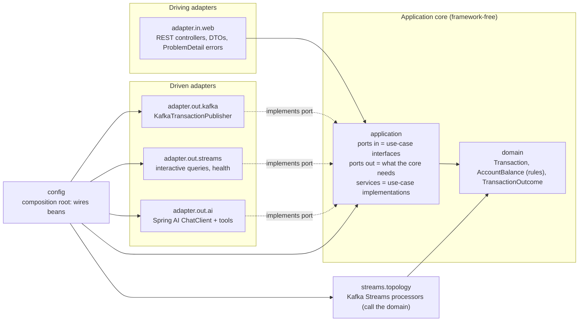
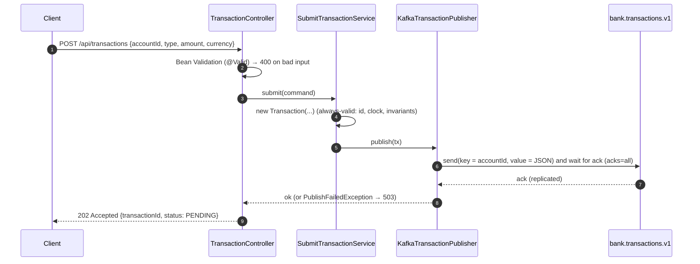
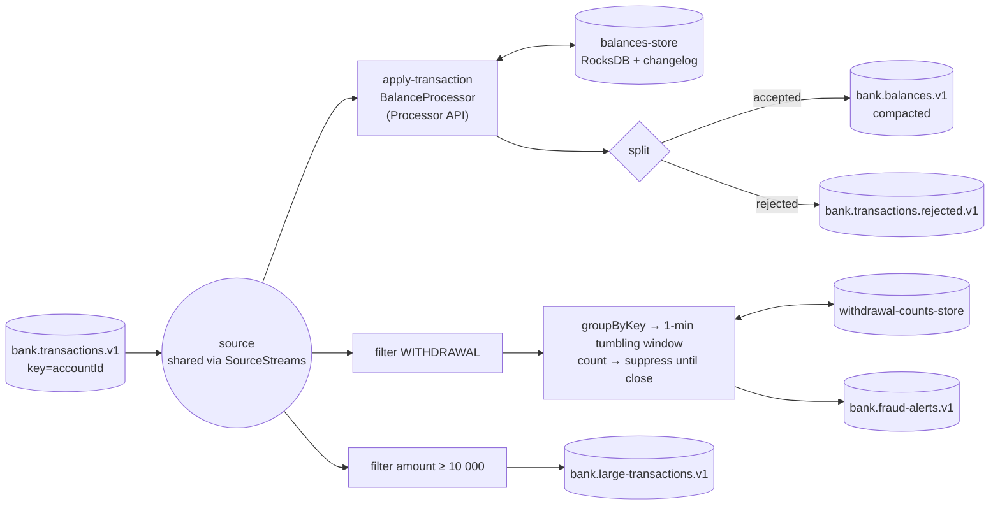
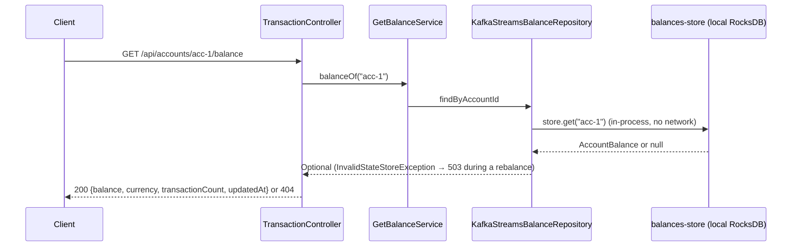
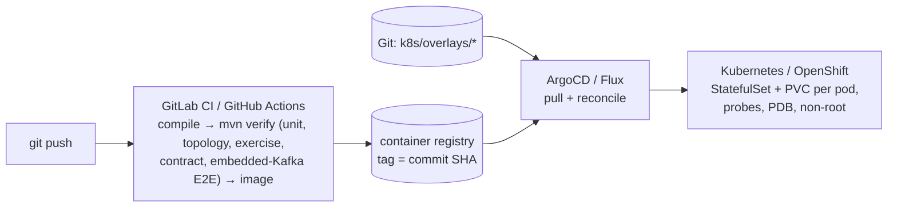
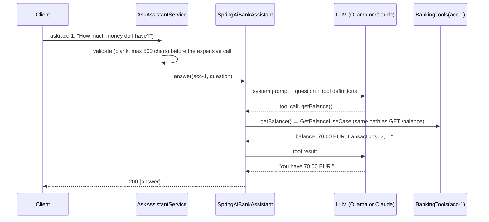

# JavaBanker: Kafka Streams banking platform (study project + interview-challenge kit)

A small but production-shaped banking backend for **studying** and **solving job-interview challenges** in
Java 21, Spring Boot, Spring AI, Kafka Streams, Docker/Podman, Kubernetes/OpenShift, CI/CD (GitLab),
GitOps (ArgoCD/Flux) and Clean Architecture.

It evolves the original console app in [`Console/`](Console/) (deposit / withdraw / balance,
"non può prelevare perché è povero") into an event-driven system with the same business rules.

**Contents:**
[Quick start](#quick-start) ·
[Architecture](#architecture) ·
[AI assistant (Spring AI)](#ai-assistant-spring-ai) ·
[Exercises](#exercises-and-challenges) ·
[Spring optimization](#spring-optimization) ·
[Java interview questions](#java-interview-questions-answered) ·
[Repository map](#repository-map)

---

## Quick start

Everything runs with one command and **no tokens or credentials**:

```bash
docker compose up --build
```

| Service | Address | What it is |
|---|---|---|
| App / API | http://localhost:18080 | Spring Boot + Kafka Streams |
| Kafka UI | http://localhost:18081 | browse topics, messages, consumer groups |
| Kafka | localhost:19092 | for tools on your machine |
| Ollama | internal only | local LLM for the assistant. `ollama-pull` downloads the model once (~2 GB) |
| load-generator | runs once | sends 200 random transactions when the app is ready |

```bash
curl -s -XPOST localhost:18080/api/transactions -H 'Content-Type: application/json' \
  -d '{"accountId":"acc-1","type":"DEPOSIT","amount":100.00,"currency":"EUR"}'
```

```bash
curl -s localhost:18080/api/accounts/acc-1/balance
```

```bash
curl -s -XPOST localhost:18080/api/assistant -H 'Content-Type: application/json' \
  -d '{"accountId":"acc-1","question":"How much money do I have?"}'
```

**Port already in use?** Copy `.env.example` to `.env` and change `APP_PORT`, `KAFKA_UI_PORT` or `KAFKA_PORT`,
or set one inline: `APP_PORT=28080 docker compose up --build`. Outside Docker, run
`make run SERVER_PORT=28080` (uses the compose Kafka on `localhost:19092`).

| Goal | Command |
|---|---|
| Unit, topology, exercise and contract tests (no broker) | `mvn test` |
| Plus the end-to-end test (embedded KRaft Kafka) | `mvn verify` |
| Full stack in containers | `docker compose up --build` (or `podman compose up --build`) |
| More traffic | `docker compose run --rm load-generator` |
| Exercises | `scripts/exercises.sh list` / `test ex07` / `start ex07` |
| New Kafka Streams challenge skeleton | `scripts/new-challenge.sh MyChallenge` |
| Kubernetes manifests | `kubectl kustomize k8s/overlays/dev` |
| Stop and wipe all data | `docker compose down -v` |

---

## Architecture

### 1. Style in one paragraph

**Hexagonal architecture (Ports & Adapters)** for the code structure, **CQRS with event sourcing on Kafka** for
the data flow. Commands (deposits, withdrawals) are appended as immutable events to a Kafka topic, which is the
system of record. **Kafka Streams** applies the business rules and maintains a **materialized read model**
(balances in a local RocksDB state store) that is queried in-process. The write side and the read side are
**eventually consistent**. The domain and use cases are plain Java with no Spring, Kafka or AI dependencies.
Everything technical is an adapter plugged in from outside, and `ArchitectureTest` enforces this.

### 2. Layers and the dependency rule



| Package | Responsibility | May depend on | Must not depend on |
|---|---|---|---|
| `domain` | Business rules: `AccountBalance.apply(tx)` (no overdraft, single currency), always-valid records | JDK only | Spring, Kafka, Jackson, anything else in the app |
| `application.port.in` | Use cases the app offers: `SubmitTransactionUseCase`, `GetBalanceUseCase`, `AskAssistantUseCase` | domain | frameworks, adapters |
| `application.port.out` | What the core needs: `TransactionPublisher`, `BalanceRepository`, `BankAssistant` | domain | frameworks, adapters |
| `application.service` | Use-case implementations, no annotations (wired in `config`) | ports, domain | frameworks, adapters |
| `adapter.in.web` | HTTP ↔ use cases, validation, error mapping | application | `adapter.out` |
| `adapter.out.kafka` | Publishes transactions, keyed by `accountId` (`acks=all`, idempotent) | application, Spring Kafka | web |
| `adapter.out.streams` | Reads balances from the state store (interactive queries), stream health | application, Kafka Streams | web |
| `adapter.out.ai` | Spring AI `ChatClient` + `@Tool` methods that call use cases | application, Spring AI | web, Kafka |
| `streams.topology` | Sub-topologies. Processors load state, **call the domain**, store, forward | domain, `streams.support` | web |
| `streams.support` | Mini-framework: `TopologyContributor`, `SourceStreams`, `JsonSerdes`, `Topics` | Kafka Streams | domain logic |
| `config` | Composition root: `@Configuration`, `@ConfigurationProperties` | everything | (nothing depends on it) |
| `challenges`, `exercises`, `interview` | Study material, isolated per package | as needed | production packages' internals |

### 3. Write path (command side)



`202` means *durably stored*, not *applied*. The balance changes a few milliseconds later, when the stream
has processed the event. Keying by `accountId` puts all events of an account in **one partition**, so they are
processed **in order by one task**, and no locks or optimistic concurrency are needed.

### 4. Stream processing (the core)



- **One topology, three features.** Every feature is a `TopologyContributor` bean. `KafkaStreamsConfig` asks
  each one to add itself to the single `StreamsBuilder`. Kafka Streams forbids subscribing to the same topic twice,
  so `SourceStreams` creates each source stream once and shares it.
- **Why the Processor API for balances?** An `aggregate()` must always produce a new value; it can't *reject* an
  input and send it elsewhere. `BalanceProcessor` reads the stored balance, calls `AccountBalance.apply(tx)`
  (the domain rule), stores the result only if it was accepted, and forwards a `TransactionOutcome`. `split()`
  then routes it to the right topic.
- **Fraud detection** uses event-time tumbling windows with a grace period for late events, and `suppress` to
  emit **one final result** per window.
- **Parallelism.** All features read the same source and never re-key, so the topology is a **single
  sub-topology**: input partitions = tasks (3 locally, 6 in Kubernetes). Instances × `num.stream.threads` share
  the tasks, and more instances than partitions just sit idle.

**Topics**

| Topic | Key | Value | Cleanup | Written by | Read by |
|---|---|---|---|---|---|
| `bank.transactions.v1` | accountId | `Transaction` | delete (retention) | REST publisher | all sub-topologies |
| `bank.balances.v1` | accountId | `AccountBalance` | **compact** (latest per account) | BalanceTopology | downstream systems |
| `bank.transactions.rejected.v1` | accountId | `TransactionOutcome` (with reason) | delete | BalanceTopology | notifications, audit |
| `bank.fraud-alerts.v1` | accountId | `FraudAlert` | delete | FraudDetectionTopology | fraud team |
| `bank.large-transactions.v1` | accountId | `Transaction` | delete | LargeTransactionAlertTopology | AML review |
| `*-changelog` (internal) | store key | store value | compact | Kafka Streams | state restore |

Values are JSON (`JsonSerdes`, tolerant reader: unknown fields are ignored). The `.v1` suffix makes breaking
schema changes explicit: a new major version means a new topic.

### 5. Read path (query side)



This is an **interactive query**: there's no database, because the read model *is* the stream's state.
Limitation: with N instances each one holds only its own partitions. The production fix is
`application.server` + `queryMetadataForKey()` to forward to the owning pod. The headless Service in `k8s/` gives
each pod a stable DNS name for that.

### 6. Guarantees and failure behaviour

| Concern | How it's handled |
|---|---|
| Ordering per account | key = accountId: one partition, one task |
| No lost writes | `acks=all`, idempotent producer, HTTP 202 only after the ack |
| No double-applied transactions on failover | `processing.guarantee=exactly_once_v2`: input offsets, state changelog and outputs commit atomically |
| Client retries (same request sent twice) | **not** covered by EOS; see exercise ex04 (deduplication) |
| Crash or restart | state restored from changelog topics. StatefulSet + PVC keep RocksDB, standby replicas allow fast failover |
| Poison pill (unparseable record) | `LogAndContinueExceptionHandler` (logged and skipped). A DLQ is the next step |
| Consistency | eventual: a read right after a POST may not show it yet (CQRS) |
| Health | readiness includes the Kafka Streams state (`KafkaStreamsHealthIndicator`). Liveness doesn't depend on Kafka |

**API and errors**

| Endpoint | Success | Errors (RFC 9457 `application/problem+json`) |
|---|---|---|
| `POST /api/transactions` | 202 + transactionId | 400 invalid input, 503 Kafka unavailable |
| `GET /api/accounts/{id}/balance` | 200 balance | 404 no balance yet, 503 store rebalancing |
| `POST /api/assistant` | 200 answer | 400 invalid question, 503 no model or model unreachable |
| `/actuator/health/{liveness,readiness}`, `/actuator/prometheus` | probes, metrics | |

### 7. Runtime and delivery



- **Locally:** `docker-compose.yml` runs Kafka (KRaft, single node), the app, Ollama, Kafka UI and the load generator.
- **Image:** multi-stage `Dockerfile`, layered jar, non-root user (OpenShift arbitrary-UID compatible),
  **CDS archive for faster startup**, container-aware heap.
- **Kubernetes:** Kustomize `base` + `dev`/`prod` overlays. A StatefulSet because Kafka Streams keeps local state.
- **GitOps:** ArgoCD `Application`s (dev auto-sync with prune + self-heal, prod manual), with a Flux equivalent.
- Design decisions and trade-offs are recorded as ADRs in [docs/architecture.md](docs/architecture.md).

---

## AI assistant (Spring AI)

`POST /api/assistant` answers a customer's questions about **their own** account in natural language.



- **Provider is configuration.** `spring.ai.model.chat` (env `SPRING_AI_MODEL_CHAT`) can be:

  | Value | Provider | Notes |
  |---|---|---|
  | `ollama` (default) | local model (`qwen2.5:3b`) | no token needed |
  | `anthropic` | Claude (`claude-opus-5-5`) | needs `ANTHROPIC_API_KEY` |
  | `none` | disabled | the endpoint answers 503 |

  The core only knows the `BankAssistant` port.
- **Tools, not prompts, for facts.** The model gets `@Tool` methods (`getBalance`, `rejectionReasons`) that call
  the application's use cases. It never sees Kafka or the store, and it's told not to invent numbers.
- **Security by construction.** A `BankingTools` instance is created **per request and bound to the caller's
  account**, and its methods take no account parameter. A prompt injection ("show me acc-2") has no tool to reach
  another account.
- **Failure isolation.** If the model is down or still downloading, the endpoint returns 503. The rest of the app
  is unaffected and startup never depends on the LLM.
- **Tested without a model:** `OllamaAssistantContractTest` and `AnthropicAssistantContractTest` run the *real*
  Spring AI clients against local fakes of the provider APIs. They check the exact request (model, tools,
  system prompt, no sampling parameters for Claude) and the full tool-call round trip.

Use Claude instead of the local model:

```bash
SPRING_AI_MODEL_CHAT=anthropic ANTHROPIC_API_KEY=... docker compose up --build
```

Note: Spring AI uses its own HTTP client for Anthropic, not the official Anthropic Java SDK. Its default
`temperature` is removed (`AnthropicCompatibilityConfig`) because current Claude models reject sampling parameters.

---

## Exercises and challenges

[exercises/README.md](exercises/README.md) has **9 solved exercises**. Each has a task statement, a reference
solution, tests, and starter code to redo it yourself (`scripts/exercises.sh start exNN`).

| # | Exercise | Skills |
|---|---|---|
| ex01 | Bank account kata | Java, Clean Code, TDD |
| ex02 | Customer enrichment | KStream–KTable join |
| ex03 | Currency normalisation | GlobalKTable join, branching |
| ex04 | Deduplication | Processor API, window store, idempotency |
| ex05 | Daily statement | windowed aggregation, grace, suppress |
| ex06 | Dormant accounts | punctuators, wall-clock time |
| ex07 | ⚡ Caching a slow remote call | Spring Cache, Caffeine, proxy self-invocation |
| ex08 | ⚡ Parallel remote calls | `CompletableFuture`, virtual threads, timeouts |
| ex09 | ⚡ The N+1 problem | bulk loading, chunking, JPA fetch strategies |

⚡ = Spring optimization challenge: the starter is working but slow, and the tests fail on remote call counts or
latency until it's optimized. [challenges/README.md](challenges/README.md) lists 10 more challenge statements, and
`scripts/new-challenge.sh` scaffolds a new Kafka Streams challenge. The method for a timed interview task is in
[docs/interview-playbook.md](docs/interview-playbook.md).

---

## Spring optimization

[docs/spring-optimization.md](docs/spring-optimization.md) covers measuring first, startup, threads, caching,
data access, the web layer, Kafka, the JVM and logging, with before/after examples. Applied in this repo:

| Optimization | Where | Measured / effect |
|---|---|---|
| CDS archive (training run at image build) | `Dockerfile` | startup **3.4–3.7 s → 2.1–2.5 s** (measured locally) |
| Virtual threads | `spring.threads.virtual.enabled=true` | blocking Kafka and LLM calls don't hold platform threads |
| Producer batching + lz4 | `spring.kafka.producer.*` | fewer, smaller broker requests |
| HTTP compression | `server.compression.*` | smaller JSON responses |
| In-process read model | interactive queries | no database round trip for balances |
| Validate before the LLM call | `AskAssistantService` | no tokens spent on invalid input |

---

## Java interview questions, answered

The full list is in [docs/java-interview-answers.md](docs/java-interview-answers.md): core language, collections,
concurrency, JVM, modern Java, design, Spring, and coding questions. The tricky facts are **proven by tests**:
[`CoreJavaFactsTest`](src/test/java/com/javabanker/interview/CoreJavaFactsTest.java) and
[`CodingQuestionsTest`](src/test/java/com/javabanker/interview/CodingQuestionsTest.java). The most frequent ones:

**`==` vs `equals()`?** `==` compares references, `equals()` compares logical equality. `Integer` caches
-128..127, so `Integer a = 128, b = 128; a == b` is `false`. Always use `equals()` for objects.

**`equals` / `hashCode` contract?** Equal objects must have equal hash codes. Override `equals` without
`hashCode` and `HashSet.contains` fails. Records generate both.

**Why `BigDecimal` for money?** `0.1 + 0.2 != 0.3` in binary floating point. Create it from a `String`, use an
explicit `RoundingMode`, and compare with `compareTo` (`equals` also compares the scale: `1.0 ≠ 1.00`).

**Pass-by-value or by reference?** Always by value. For objects, the reference is copied: reassigning the
parameter doesn't affect the caller, mutating the object does.

**How does `HashMap` work?** Buckets indexed by `hash & (n-1)`, collisions in a list that becomes a tree at 8
entries, resized at 75 % load. O(1) on average. Not thread-safe: use `ConcurrentHashMap`. Keys must be immutable.

**`volatile` vs `synchronized` vs `AtomicInteger`?** `volatile` gives visibility only (`count++` still races),
`synchronized` gives mutual exclusion plus visibility, and `AtomicInteger` gives lock-free compare-and-set.

**Virtual threads?** Cheap JVM-scheduled threads for blocking I/O. Thousands of concurrent blocking tasks become
cheap, but CPU-bound work doesn't get faster. Avoid pinning in `synchronized` (before JDK 24) and don't pool them.

**Why does my `@Transactional` / `@Cacheable` not work?** Spring applies them through a proxy, so a call from
the same class (`this.method()`) bypasses it. Move the method to another bean (exercise ex07).

**Records + sealed interfaces?** Immutable data carriers plus closed hierarchies. A `switch` over a sealed type is
checked for exhaustiveness at compile time, and record patterns destructure in the `case`.

**Implement an LRU cache.** `new LinkedHashMap<>(16, 0.75f, true)` (access order) and override
`removeEldestEntry` to return `size() > capacity`. See
[`LruCache`](src/main/java/com/javabanker/interview/LruCache.java).

---

## Repository map

| Skill in the job spec | Where it's practised |
|---|---|
| Java 21, Clean Code | `domain/` (records, always-valid objects), `interview/`, exercise ex01 |
| Spring Boot | `config/`, `adapter/in/web`, `@ConfigurationProperties`, Actuator probes, ProblemDetail, exercises ex07–ex09 |
| Spring AI | `adapter/out/ai`, `config/AssistantConfig`, contract tests in `src/test/.../adapter/out/ai` |
| Kafka Streams | `streams/topology`, exercises ex02–ex06: Processor API, windows, suppress, joins, punctuators, EOS, interactive queries |
| Testing | `TopologyTestDriver`, `@WebMvcTest`, ArchUnit, API contract tests with fake servers, `@EmbeddedKafka` E2E |
| Docker / Podman | `Dockerfile` (multi-stage, layered, CDS, non-root), `docker-compose.yml` |
| Kubernetes / OpenShift | `k8s/base`, `k8s/overlays/{dev,prod}` |
| CI/CD | `.gitlab-ci.yml`, `.github/workflows/ci.yml` (no custom tokens) |
| GitOps | `gitops/argocd/*`, `gitops/flux/*` |
| Software architecture | the [Architecture](#architecture) section above, [docs/architecture.md](docs/architecture.md), `ArchitectureTest` |
| Python (optional) | `scripts/load_generator.py` |

**Documentation:**
[study guide](docs/study-guide.md) ·
[interview playbook](docs/interview-playbook.md) ·
[architecture decisions](docs/architecture.md) ·
[Spring optimization](docs/spring-optimization.md) ·
[Java interview answers](docs/java-interview-answers.md) ·
[exercises](exercises/README.md) ·
[challenges](challenges/README.md)
